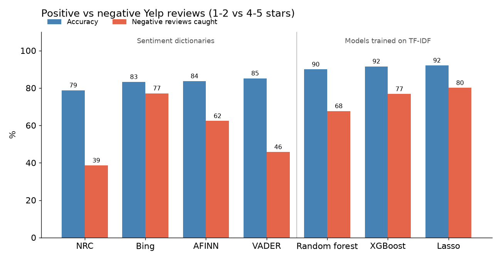
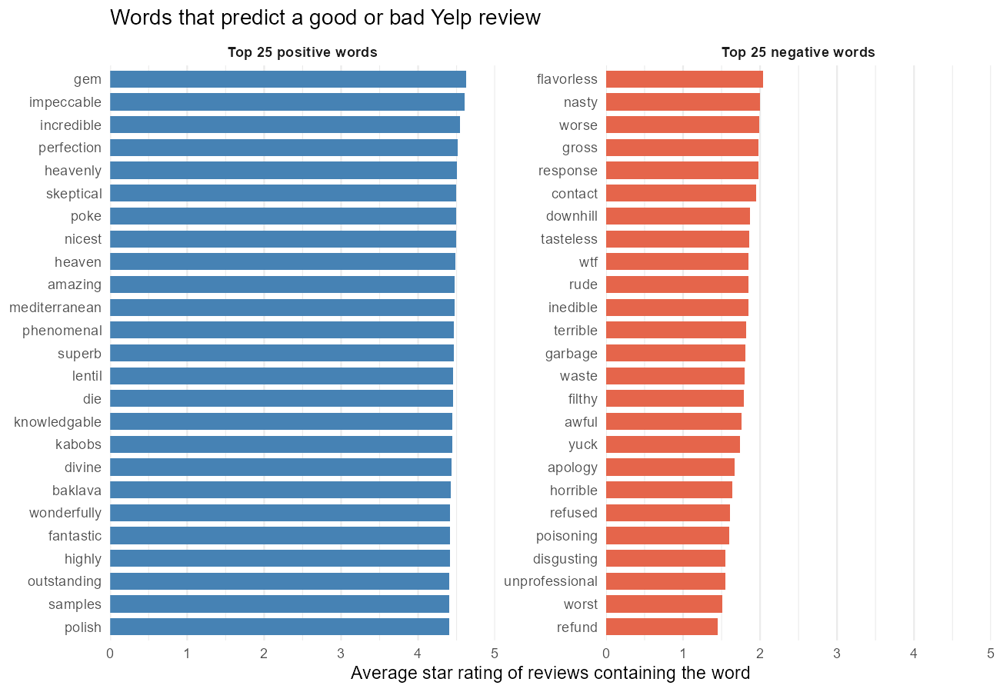
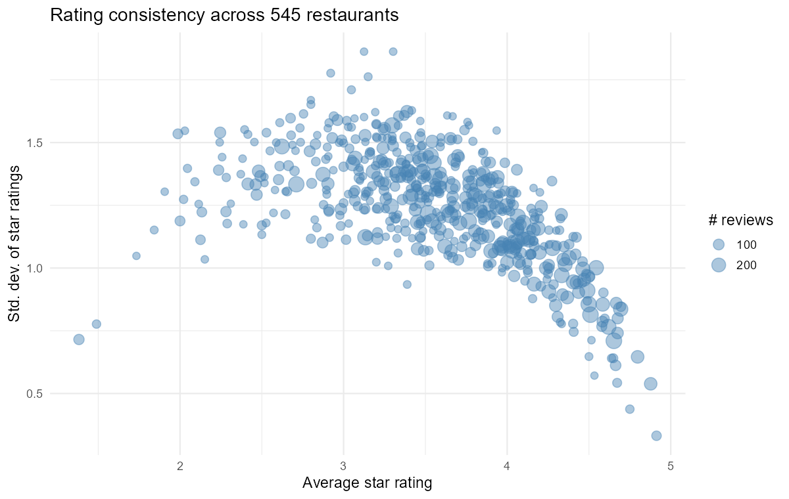

# Yelp Restaurant Reviews: Text Mining and Sentiment Analysis

IDS 572 Data Mining for Business, University of Illinois Chicago, Spring 2026. Analysis by Orcun Tasdemir.

## The question

Can you tell whether a restaurant review is positive (4-5 stars) or negative (1-2 stars) from its text alone? I compared off-the-shelf sentiment dictionaries with models trained on the review text.

## Data

The data is a sample of 48,246 Yelp reviews of 545 restaurants. Ratings skew positive: 64% of reviews give 4 or 5 stars. Restaurants with high averages are also the most consistent. The correlation between a restaurant's average rating and the spread of its ratings is -0.57.

## What I did

- **Cleaned the text** with tidytext: tokenized it, removed stop words and numbers, lemmatized the words, and pruned very rare and very common terms.
- **Found the words that predict ratings**, by averaging the stars of the reviews each word appears in. The top positive words were "gem", "impeccable" and "incredible". The top negative words were "refund", "worst" and "unprofessional".
- **Checked where dictionaries get context wrong.** For example, "die" (as in "to die for") and "skeptical" (as in "I was skeptical, but...") both show up mostly in positive reviews.
- **Scored every review with four dictionary methods**: Bing, NRC and AFINN through tidytext, and VADER through Python called from R with reticulate.
- **Built a TF-IDF document-term matrix** (41,324 reviews by 4,308 lemmas) and trained three models on a 50/50 split:
  - Lasso logistic regression (cv.glmnet)
  - Random forest (ranger, grid search over mtry and node size)
  - XGBoost (grid search over depth, learning rate, child weight and column sampling, with 5-fold CV and early stopping)

## Results

| Method | Accuracy | Negative reviews caught | Test AUC |
|---|---|---|---|
| NRC dictionary | 78.8% | 38.6% | |
| Bing dictionary | 83.3% | 77.2% | |
| AFINN dictionary | 83.7% | 62.4% | |
| VADER | 85.2% | 45.8% | |
| Random forest | 90.0% | 67.7% | 0.956 |
| XGBoost | 91.6% | 76.8% | 0.963 |
| **Lasso logistic regression** | **92.1%** | **80.1%** | **0.965** |

The dictionaries look reasonable on accuracy, because most reviews are positive. They miss many negative reviews, which are the ones a restaurant most needs to find. A sparse lasso model trained on the review text was both the most accurate method and the best at catching negative reviews.

The dictionary methods were scored on all reviews with matching words. The trained models were scored on the held-out half.

## Files

- `yelp_sentiment.Rmd` is the full R Markdown analysis.
- `figures/` holds charts from the analysis.

The review sample came from the course and is drawn from the Yelp Open Dataset. Its terms do not allow redistribution, so the data is not included.

**R packages:** tidyverse, tidytext, textdata, textstem, glmnet, ranger, xgboost, pROC, reticulate (with Python vaderSentiment)
